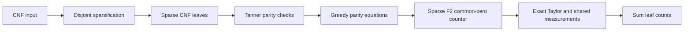

# ETH-SAT Research Engine


An exact-arithmetic Python research implementation of a deterministic pipeline
for counting satisfying assignments of fixed-width CNF formulas.

> **Research prototype:** the implementation has small-instance correctness
> tests, but no large-instance runtime or memory qualification. The paper's
> asymptotic theorem is not established by this repository's tests.

An opt-in [Anthropic crossing-reduction reference](research_anthropic/README.md)
contains exact small-instance experiments. It is not the complete Network/Clique
algorithm and does not implement OpenAI's Appendix D deformation.

## Contents

- [Research basis](#research-basis)
- [Algorithm pipeline](#algorithm-pipeline)
- [Install](#install)
- [Count models: `sat-count`](#count-models-sat-count)
- [Use](#use)
- [Resource guards](#resource-guards)
- [Engines](#engines)
- [Verify](#verify)
- [Project structure](#project-structure)
- [License](#license)

## Research basis

This project implements the reduction and counting stages described in
[OpenAI's manuscript, *The Exponential Time Hypothesis is False*](https://github.com/openai/math/blob/main/preprints/The-Exponential-Time-Hypothesis-is-False-October-25-2026/build/main_full_version.tex).
The manuscript states a deterministic subexponential-time, polynomial-space
algorithm for exact #k-SAT when `k` is fixed. This repository is an engineering
implementation of that pipeline; it does not provide an independent proof or
qualification of the manuscript's complexity bounds.

## Algorithm pipeline



The implementation includes:

- Exact rational polynomial and Hermite interpolation routines.
- Sparse multilinear polynomial equations over F2.
- Deterministic sparsification and parity-test construction.
- High-incidence branching, balanced schedules, and shared-measurement sums.
- Exhaustive and DPLL references for independent small-instance checks.
- A DIMACS command-line interface and Windows launcher.

## Install

Requires Python 3.10 or newer. Runtime dependencies are from the Python
standard library.

```console
python -m pip install -e .
```

On Windows, run `run_windows.bat` for the bundled cross-engine example.

## Count models: `sat-count`

A practical exact model counter. It runs a fast engine side by side with
independent engines, each in its own process, and prints a count only when
every engine that finished agrees.

```console
python -m pip install -e ".[count]"     # adds Ganak through pyganak
sat-count examples/simple.cnf
```

The count goes to standard output and one status line to standard error:

```text
4
exact, cross-checked by 4 engines [ganak 0.215s; bitset 0.207s; elimination 0.208s; dpll 0.209s]
```

| Engine | What it is | Used when |
| --- | --- | --- |
| `ganak` | [Ganak](https://github.com/meelgroup/ganak) through `pyganak` | installed |
| `bitset` | truth-table counting, sharing no code with the others | at most 24 variables |
| `elimination` | variable elimination over clause tables | always tried; it stops if a step needs a table over more than 18 variables |
| `veritas` | the R9.12 structure-aware counter | the R9.12 `veritas` package is importable (v3.8.2 lacks the module) |
| `dpll` | this repository's pure-Python DPLL counter | no projection set |

`elimination` is what cross-checks long chains, grids and other narrow
formulas, where `dpll` is too slow and `bitset` does not apply.

Input is DIMACS CNF. XOR lines in CryptoMiniSat form (`x1 -2 3 0`) and
projection sets (`c p show 1 2 0` or `c ind 1 2 0`) are supported. Files ending
in `.gz`, `.bz2` or `.xz` are decompressed. Weighted counting is refused.

Useful options:

- `--json` prints the full record: every engine, its status, time and count,
  and the size of the count in digits and bits.
- `--timeout` is the limit for each engine. Once one engine has a count, the
  others get `--verify-timeout` more seconds. Every engine runs in its own
  process and is killed at its limit.
- `--jobs` sets how many engines run at once (default: one per processor).
- `--require-cross-check` fails unless two engines finished and agree.
- `--engines ganak,bitset` picks engines.
- `--no-verify` runs the first engine only.

Exit codes: `0` exact count, `2` no engine finished, `3` engines disagree (no
count is printed), `4` not cross-checked when required, `64` bad input.

```python
from eth_sat.counter import count_models, parse_dimacs

result = count_models(parse_dimacs(open("examples/simple.cnf").read()))
print(result.status, result.count, result.agreeing_engines)
```

Without `pyganak` the tool still works, within limits:

- At most 24 variables: `bitset` counts them.
- Narrow formulas of any size: `elimination` counts them, with or without a
  projection set.
- Everything else falls to `dpll`, which is slow beyond small or highly
  structured inputs and does not handle projection sets. A wide projected
  formula with more than 24 variables then has no result.

Install the `count` extra to lift these limits. With or without it, any engine
can hit its time limit. A cross-check that times out is reported as such and
does not count as agreement, and if every engine times out there is no result.

This is
ordinary exponential-worst-case model counting; it does not use the research
pipeline below and is no evidence for any subexponential bound.

## Use

Compare the exact reference engines on the bundled example:

```console
python -m eth_sat --example simple --engine compare
```

Count a DIMACS file with the research pipeline:

```console
python -m eth_sat --input examples/simple.cnf --engine subexponential
```

The Python API is also available:

```python
from eth_sat.model import CNF
from eth_sat.subexponential import count_subexponential

formula = CNF.from_dimacs("examples/simple.cnf")
result = count_subexponential(formula)
print(result.count)
print(result.sparsification_sigma, result.leaves_processed)
```

The algorithm's theorem-level statement assumes a fixed maximum clause width
`k`. Inputs with growing clause width are accepted by the data model, but are
outside that fixed-`k` performance claim.

## Resource guards

The CLI protects against unexpectedly large exact searches. Defaults limit
finite-size exhaustive fallbacks to 24 variables and the Tanner/parity
candidate searches to 100,000 candidates. Use `-1` to disable each limit:

```console
python -m eth_sat --input formula.cnf --engine subexponential \
  --max-fallback-variables -1 \
  --max-construction-candidates -1 \
  --max-parity-candidates -1
```

Disabling a guard permits the full deterministic search and can result in very
long runtimes. The exact dense auxiliary construction is uncapped by default
for this engine; `--max-subexponential-auxiliary-dimension N` can add a cap.

## Engines

| Engine | Purpose |
| --- | --- |
| `subexponential` | Manuscript-derived sparsification, parity compression, and common-zero pipeline |
| `spectral` | Exact Taylor/shared-measurement reference for small formulas |
| `algebraic` | Polynomial interpolation reference |
| `shared` | Generic shared-measurement CNF reference |
| `grouped` | Grouped factor-counting baseline |
| `dpll` | Independent exact DPLL counter |
| `compare` | Runs algebraic, shared, spectral, and DPLL counters |

The reference engines use a default 24-variable guard. The small spectral
engine also defaults to a 64-dimensional auxiliary limit and a 100,000-pair
Taylor limit.

## Verify

```console
python -m pip install -e ".[test]"
python -m pytest -q tests
python -m compileall -q eth_sat tests
python -m eth_sat --example simple --engine compare
python -m eth_sat --example simple --engine subexponential
```

`pytest` is required: two test modules are pytest-style, and plain
`python -m unittest discover` silently skips them. NumPy is optional and only
speeds up the exhaustive reference counter.

Tests check count-preserving reductions and compare small outputs with
exhaustive or DPLL references. They are correctness evidence for tested inputs,
not evidence of the asymptotic runtime or a formal verification of the paper.

## Project structure

- `eth_sat/reductions.py` — disjoint sparsification and count-preserving CNF reductions.
- `eth_sat/subexponential.py` — Tanner checks, greedy parity compression, and pipeline entry point.
- `eth_sat/sparse.py`, `eth_sat/common_zeros.py` — sparse F2 systems and exact common-zero counting.
- `eth_sat/parameters.py`, `layout.py`, `spectral.py`, `schedules.py` — exact design and incidence construction.
- `eth_sat/taylor.py`, `measurements.py`, `polynomial.py` — Taylor jets, shared sums, and interpolation.
- `eth_sat/counter.py` — the `sat-count` tool: DIMACS parsing, engines, cross-checking.
- `tests/` — unit and differential tests.
- `docs/ROADMAP.md` — implementation status and remaining qualification work.

## License

MIT. See [`LICENSE`](LICENSE).
