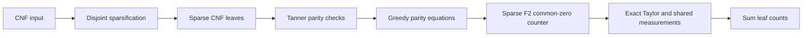

# ETH-SAT Research Engine


An exact-arithmetic Python research implementation of a deterministic pipeline
for counting satisfying assignments of fixed-width CNF formulas.

> **Research prototype:** the implementation has small-instance correctness
> tests, but no large-instance runtime or memory qualification. The paper's
> asymptotic theorem is not established by this repository's tests.

## Contents

- [Research basis](#research-basis)
- [Algorithm pipeline](#algorithm-pipeline)
- [Install](#install)
- [Use](#use)
- [Resource guards](#resource-guards)
- [Engines](#engines)
- [Verify](#verify)
- [Project structure](#project-structure)
- [License](#license)

## Research basis

This project implements the reduction and counting stages described in
[OpenAI's manuscript, *The Exponential Time Hypothesis is False*](https://github.com/openai/math/blob/main/preprints/The-Exponential-Time-Hypothesis-is-False-October-25-2026/build/main_full_version.tex).
The manuscript states a deterministic subexponential-time, polynomial-space
algorithm for exact #k-SAT when `k` is fixed. This repository is an engineering
implementation of that pipeline; it does not provide an independent proof or
qualification of the manuscript's complexity bounds.

## Algorithm pipeline



The implementation includes:

- Exact rational polynomial and Hermite interpolation routines.
- Sparse multilinear polynomial equations over F2.
- Deterministic sparsification and parity-test construction.
- High-incidence branching, balanced schedules, and shared-measurement sums.
- Exhaustive and DPLL references for independent small-instance checks.
- A DIMACS command-line interface and Windows launcher.

## Install

Requires Python 3.10 or newer. Runtime dependencies are from the Python
standard library.

```console
python -m pip install -e .
```

On Windows, run `run_windows.bat` for the bundled cross-engine example.

## Use

Compare the exact reference engines on the bundled example:

```console
python -m eth_sat --example simple --engine compare
```

Count a DIMACS file with the research pipeline:

```console
python -m eth_sat --input examples/simple.cnf --engine subexponential
```

The Python API is also available:

```python
from eth_sat.model import CNF
from eth_sat.subexponential import count_subexponential

formula = CNF.from_dimacs("examples/simple.cnf")
result = count_subexponential(formula)
print(result.count)
print(result.sparsification_sigma, result.leaves_processed)
```

The algorithm's theorem-level statement assumes a fixed maximum clause width
`k`. Inputs with growing clause width are accepted by the data model, but are
outside that fixed-`k` performance claim.

## Resource guards

The CLI protects against unexpectedly large exact searches. Defaults limit
finite-size exhaustive fallbacks to 24 variables and the Tanner/parity
candidate searches to 100,000 candidates. Use `-1` to disable each limit:

```console
python -m eth_sat --input formula.cnf --engine subexponential \
  --max-fallback-variables -1 \
  --max-construction-candidates -1 \
  --max-parity-candidates -1
```

Disabling a guard permits the full deterministic search and can result in very
long runtimes. The exact dense auxiliary construction is uncapped by default
for this engine; `--max-subexponential-auxiliary-dimension N` can add a cap.

## Engines

| Engine | Purpose |
| --- | --- |
| `subexponential` | Manuscript-derived sparsification, parity compression, and common-zero pipeline |
| `spectral` | Exact Taylor/shared-measurement reference for small formulas |
| `algebraic` | Polynomial interpolation reference |
| `shared` | Generic shared-measurement CNF reference |
| `grouped` | Grouped factor-counting baseline |
| `dpll` | Independent exact DPLL counter |
| `compare` | Runs algebraic, shared, spectral, and DPLL counters |

The reference engines use a default 24-variable guard. The small spectral
engine also defaults to a 64-dimensional auxiliary limit and a 100,000-pair
Taylor limit.

## Verify

```console
python -m unittest discover -s tests -v
python -m compileall -q eth_sat tests
python -m eth_sat --example simple --engine compare
python -m eth_sat --example simple --engine subexponential
```

Tests check count-preserving reductions and compare small outputs with
exhaustive or DPLL references. They are correctness evidence for tested inputs,
not evidence of the asymptotic runtime or a formal verification of the paper.

## Project structure

- `eth_sat/reductions.py` — disjoint sparsification and count-preserving CNF reductions.
- `eth_sat/subexponential.py` — Tanner checks, greedy parity compression, and pipeline entry point.
- `eth_sat/sparse.py`, `eth_sat/common_zeros.py` — sparse F2 systems and exact common-zero counting.
- `eth_sat/parameters.py`, `layout.py`, `spectral.py`, `schedules.py` — exact design and incidence construction.
- `eth_sat/taylor.py`, `measurements.py`, `polynomial.py` — Taylor jets, shared sums, and interpolation.
- `tests/` — unit and differential tests.
- `docs/ROADMAP.md` — implementation status and remaining qualification work.

## License

MIT. See [`LICENSE`](LICENSE).
